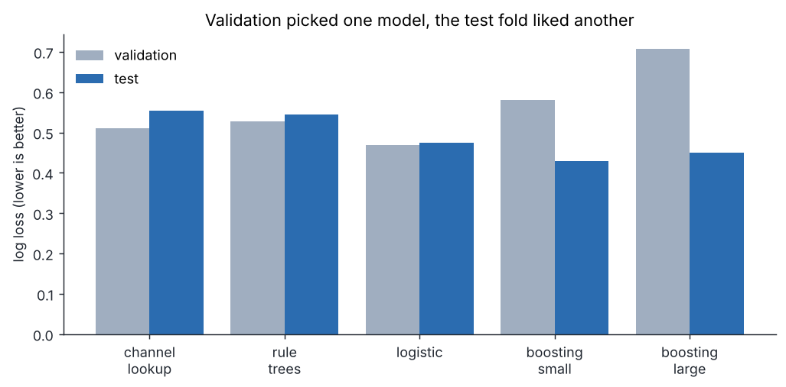
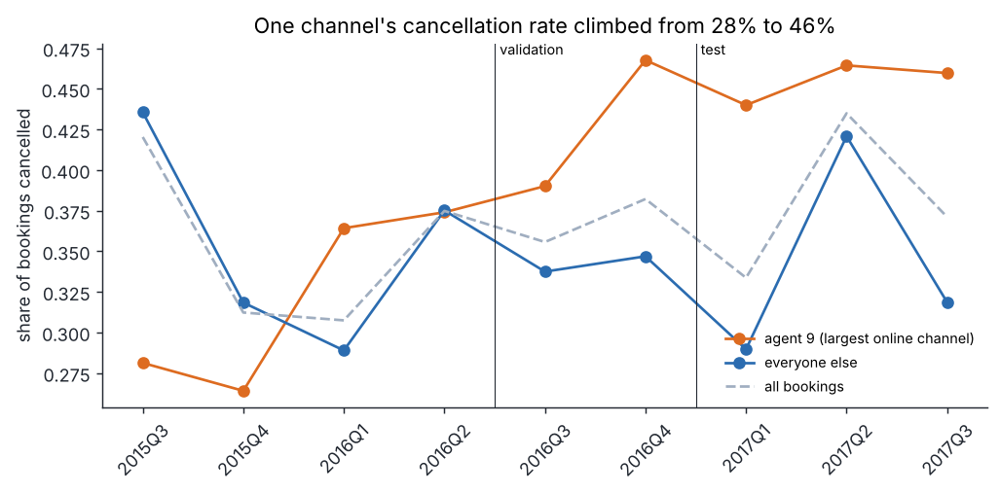
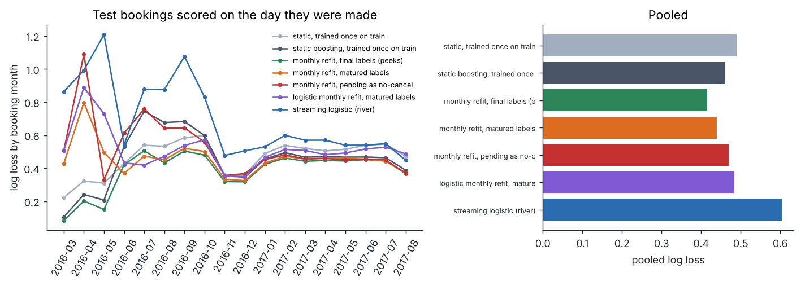
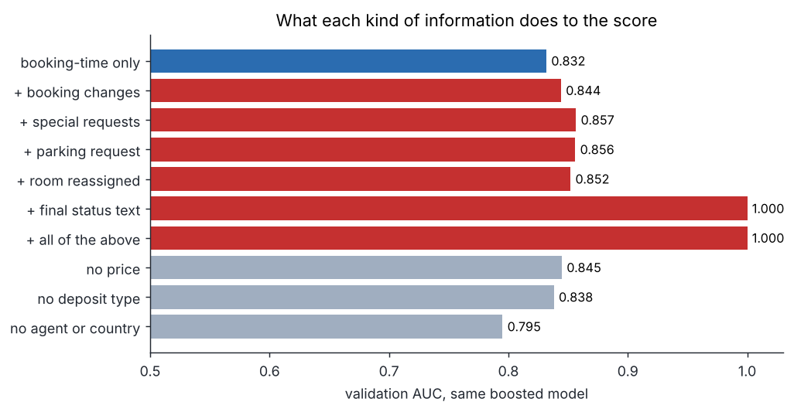
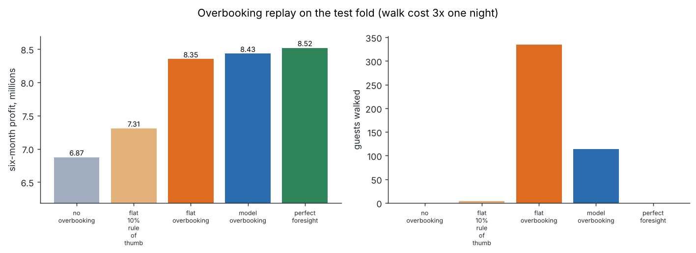
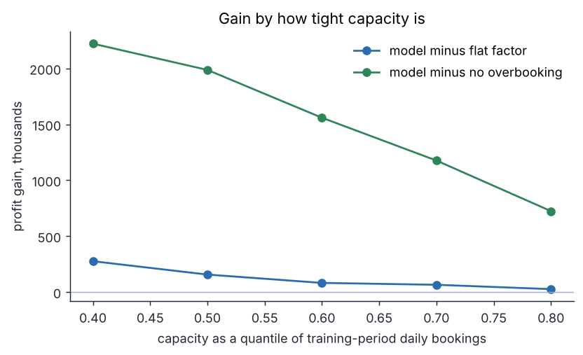
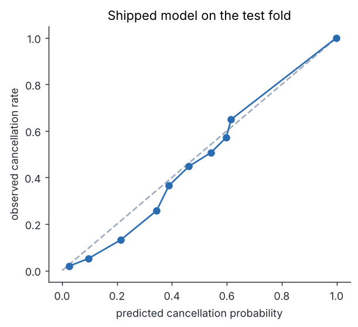

# ghostroom


A cancellation model for hotel bookings, built around three questions a revenue manager would ask before trusting it: what does the hotel actually know when a booking is confirmed, how stale can the training data be before the scores go wrong, and what is a better forecast worth in rooms and money. It scores each booking with a probability of being cancelled before arrival, explains the score in plain words, replays an overbooking policy on real outcomes, and runs a retraining study that respects the fact that a booking's label only exists once the guest cancels or checks out.

The data is the public hotel booking demand table: 119,390 bookings at a city hotel and a resort hotel in Portugal, arrivals from 2015-07-01 to 2017-08-31. 37.0% of bookings were cancelled.

## Results

Everything below is measured by `ghostroom run` and written to `outputs/metrics.json`. Splits are by arrival date: 58,792 training bookings (July 2015 to August 2016), 27,769 for validation (September 2016 to February 2017) and 32,829 for the test fold (March to August 2017). Intervals resample whole arrival weeks, because bookings in the same week are not independent.

### The shipped model

The validation rule (simplest model within one standard error of the best) chose logistic regression, and I wrapped it in an isotonic map because the validation check said raw scores were off. On the test fold it gets AUC 0.8351 [0.8157, 0.8543], log loss 0.4674 [0.4458, 0.4901] and a calibration error of 0.0354 (raw scores were 0.0543). The channel lookup a revenue desk would build by hand reaches AUC 0.7145.

| model | val log loss | val AUC | test log loss | test AUC | test ECE |
|---|---|---|---|---|---|
| channel lookup (hotel, segment, deposit) | 0.5097 | 0.7537 | 0.5541 | 0.7145 | 0.1303 |
| rule trees (FIGS, 12 rules) | 0.5272 | 0.8237 | 0.5443 | 0.8277 | 0.1761 |
| logistic regression (shipped, before the isotonic map) | 0.4681 | 0.8444 | 0.4751 | 0.8363 | 0.0543 |
| boosting, 250 trees | 0.5800 | 0.8319 | 0.4292 | 0.8617 | 0.0493 |
| boosting, 500 trees | 0.7082 | 0.8154 | 0.4499 | 0.8546 | 0.0508 |

The table has an awkward line in it. Boosting looked bad on validation (log loss 0.5800 against 0.4681 for logistic) and then won the test fold (0.4292 against 0.4751). I did not go back and pick it. My reading, from the next chart, is that one booking channel changed its behaviour while the model was frozen, and the validation window caught the boosted model at its worst moment. The retraining study below is the honest answer to that, and it points at boosting refitted every month.



### One channel drifted

Agent 9, the largest online channel, cancelled 28% of its bookings in the first quarter of data and 46% by the last, with a peak of 47% in late 2016. It is 34% of the test fold. On that fold a model trained once on the early months predicted 0.376 for it against an observed 0.458.



### Retraining under delayed labels

A booking's label arrives late. A cancellation is known on the day it happens, and a completed stay on the day the guest leaves. If you retrain on the first of a month, the bookings you made last week are mostly unresolved. I replayed that with real dates for every test booking made from March 2016 on (32,718 bookings): each is scored on its booking day by a model refit on the first of that month, built three ways.

| method | log loss [95% interval] | AUC | ECE | mean predicted |
|---|---|---|---|---|
| static, trained once on train | 0.4889 [0.4647, 0.5137] | 0.8303 | 0.0645 | 0.340 |
| static boosting, trained once on train | 0.4614 [0.4403, 0.4817] | 0.8429 | 0.0579 | 0.342 |
| logistic monthly refit, matured labels | 0.4838 [0.4560, 0.5100] | 0.8271 | 0.0359 | 0.417 |
| monthly refit, pending as no-cancel | 0.4692 [0.4476, 0.4904] | 0.8529 | 0.0906 | 0.309 |
| monthly refit, matured labels | 0.4402 [0.4193, 0.4588] | 0.8551 | 0.0299 | 0.421 |
| monthly refit, final labels (peeks) | 0.4154 [0.3958, 0.4334] | 0.8720 | 0.0331 | 0.373 |
| streaming logistic (river) | 0.6037 [0.5782, 0.6305] | 0.7417 | 0.0903 | 0.419 |

A few things stand out. Peeking at final labels, which is what a normal notebook does, looks 0.0249 log loss better than what a hotel could really have done. Counting unresolved bookings as "did not cancel" is the common shortcut and it is the worst of the three: scores come out low (mean 0.309 against 0.400 observed) and calibration error triples to 0.0906. Keeping only matured bookings is biased toward early cancellers but calibrates best (0.0299). And monthly refits help boosting a lot (0.4614 to 0.4402) while barely moving logistic regression (0.4889 to 0.4838). The intervals for static boosting and the matured refit overlap, so I would call the gap suggestive rather than settled.

The streaming logistic model from `river`, which learns each label the day it arrives, was the weakest method here (log loss 0.6037). I tuned its learning rate on validation and tried a Hoeffding tree as well, which was worse. ADWIN, the drift detector in the same library, fired 13 times on agent 9's label stream and 101 times on everyone else's, which makes it far too jumpy to trigger a retrain on its own.



`ghostroom retrain` applies the matured-label rule: it refits on the bookings whose outcome was known on a chosen date and writes a second model file next to the shipped one.

### What the hotel does not know yet

Some columns in the table are written after the booking is made: the number of changes, special requests, parking requests, room reassignment, and the final reservation status. The audit adds each to the booking-time columns and refits the same boosted model.

| variant | val AUC | val log loss |
|---|---|---|
| booking-time columns only | 0.8319 | 0.5800 |
| plus number of booking changes | 0.8441 | 0.5524 |
| plus special requests | 0.8566 | 0.5461 |
| plus parking request | 0.8560 | 0.5352 |
| plus room reassigned | 0.8521 | 0.5370 |
| plus final reservation status | 1.0000 | 0.0000 |
| without price | 0.8448 | 0.5546 |
| without deposit type | 0.8381 | 0.5440 |
| without agent and country | 0.7952 | 0.5140 |

Final status is the label under another name, which pushes AUC to 1.000. Special requests, booking changes and parking add 0.01 to 0.025 AUC each, which looks like a real gain and is not available when the decision is made. None of these are used. Removing price makes the validation score slightly better rather than worse, and removing agent and country costs 0.0367 AUC.



Two more checks on how the score is measured. The same boosted learner reaches AUC 0.914 on a random 25% of rows, 0.857 once exact duplicate rows are removed (26.8% of the file is duplicated), and 0.836 on the forward test fold. Random splits flatter this table by about 0.08 AUC.

### Overbooking replay

For each hotel and arrival date, bookings come in the order they were made and a policy decides which to accept. Guests who show up are served up to capacity and the rest are walked at a cost. I replayed the test fold on real outcomes. The assumptions are mine and are adjustable in `economics.py`: capacity is the 60th percentile of daily bookings in the training period (98 rooms city, 49 resort), a served guest pays price times nights, a walked guest pays nothing and costs three times one night's price, bookings beyond what the hotel accepts are lost, and each arrival day is treated on its own.

| policy | profit | guests walked | bookings accepted |
|---|---|---|---|
| no overbooking | $6,873,146 | 0 | 25,458 |
| flat 10% rule of thumb | $7,308,325 | 4 | 27,162 |
| flat overbooking | $8,350,363 | 335 | 32,366 |
| model overbooking | $8,432,277 | 114 | 32,244 |
| perfect foresight | $8,519,250 | 0 | 32,308 |

The model policy accepts while the expected number of shows stays under 1.10 times capacity. Its edge over the tuned flat factor is $81,913 [$8,376, $175,178], a small number next to the $1,477,218 that overbooking at all is worth. The fair summary is that most of the gain comes from overbooking, and the model's contribution is fewer walked guests (114 against 335) for slightly more profit. One caveat on the flat baseline: its tuned factor landed at the top of the grid, so it accepts nearly every booking that exists in the file, which says the demand in this table barely exceeds what an overbooking hotel can use. The simple ten percent rule of thumb earns $7,308,325.

| walk cost | tuned flat factor | tuned model cut-off | model minus flat | model minus no overbooking | share of the flat-to-foresight gap closed |
|---|---|---|---|---|---|
| 1x one night | 1.00 | 1.35 | $78,762 [$13,376, $162,070] | $1,618,720 [$1,391,616, $1,852,858] | 74% |
| 3x one night | 1.00 | 1.10 | $81,913 [$8,376, $175,178] | $1,559,131 [$1,331,399, $1,786,386] | 49% |
| 5x one night | 0.80 | 1.10 | $122,057 [$28,600, $234,337] | $1,533,421 [$1,304,242, $1,762,010] | 52% |

Tightening capacity makes the model matter more, and loosening it makes it matter less.

| capacity quantile | city / resort rooms | no overbooking | flat | model | foresight | model minus flat |
|---|---|---|---|---|---|---|
| 0.4 | 72 / 40 | $5,572,816 | $7,518,442 | $7,794,426 | $8,115,353 | $275,984 |
| 0.5 | 84 / 44 | $6,196,137 | $8,026,381 | $8,182,822 | $8,378,544 | $156,441 |
| 0.6 | 98 / 49 | $6,873,146 | $8,350,363 | $8,432,277 | $8,519,250 | $81,913 |
| 0.7 | 111 / 54 | $7,375,361 | $8,486,467 | $8,551,575 | $8,572,165 | $65,108 |
| 0.8 | 127 / 63 | $7,862,794 | $8,560,493 | $8,586,773 | $8,596,519 | $26,280 |





### Calibration and who it is wrong for

Raw scores ran low on the test fold (mean 0.357 against 0.400 observed) because cancellations kept rising. The isotonic map, fitted on validation, brought the calibration error from 0.0543 to 0.0354. The groups that remain under-predicted are the ones that moved:

| group (test fold) | bookings | observed rate | mean raw score |
|---|---|---|---|
| hotel: City Hotel | 22,542 | 0.429 | 0.409 |
| hotel: Resort Hotel | 10,287 | 0.336 | 0.242 |
| segment: Corporate | 1,027 | 0.234 | 0.185 |
| segment: Direct | 3,549 | 0.169 | 0.145 |
| segment: Groups | 4,437 | 0.606 | 0.638 |
| segment: Offline TA/TO | 5,010 | 0.353 | 0.324 |
| segment: Online TA | 18,532 | 0.420 | 0.351 |
| agent 9 | 11,008 | 0.458 | 0.411 |
| agent 240 | 3,928 | 0.494 | 0.326 |

Agent 240 and the resort hotel are under-predicted most. Non-refundable bookings cancel 99.97% of the time in this file, which is a quirk of how this property sold them rather than a behaviour to build a policy on, so the first thing the rule-tree model learns is that rule.



### Reading a score

Each score comes with the three biggest pushes on the log-odds, grouped back to the input columns. From the test fold, the highest-scored booking, one near the middle, and the lowest:

| score | what happened | pushes toward cancelling | pushes toward staying |
|---|---|---|---|
| 0.999 | cancelled | deposit terms (Non Refund), guest country (PRT), customer type (Transient) | none |
| 0.396 | cancelled | number of adults (3), booking agent (9) | deposit terms (No Deposit) |
| 0.018 | stayed | customer type (Transient) | deposit terms (No Deposit), booking agent (152) |

The rule-tree model prints as a short sum of trees, which is the version I would show a revenue manager first (numeric splits are on standardised values):

```
FIGSClassifier
  FIGS: a sum of small trees.
  depth 6  ·  13 leaves  ·  58,792 training samples  ·  classes: 0, 1
  Each tree adds the value of the leaf a sample reaches; P(1) = sigmoid(sum).

  deposit_type_Non Refund ≤ 0.5 ?                       58,792 samples
  ├─ yes previous_cancellations ≤ 0.9223 ?              50,757
  │  ├─ yes country_PRT ≤ 0.5 ?                         48,331
  │  │  ├─ yes agent_id_9 ≤ 0.5 ?                       29,607
  │  │  │  ├─ yes adr ≤ 1.746 ?                         19,086
  │  │  │  │  ├─ yes agent_id_17 ≤ 0.5 ?                17,621
  │  │  │  │  │  ├─ yes → -0.9477                       17,414
  │  │  │  │  │  └─ no  → +0.1111                          207
  │  │  │  │  └─ no  → -0.4594                           1,465
  │  │  │  └─ no  customer_type_Transient ≤ 0.5 ?       10,521
  │  │  │     ├─ yes → -0.8522                           1,854
  │  │  │     └─ no  lead_time ≤ -0.8868 ?               8,667
  │  │  │        ├─ yes → -0.6739                        1,331
  │  │  │        └─ no  → -0.07552                       7,336
  │  │  └─ no  lead_time ≤ -0.7732 ?                    18,724
  │  │     ├─ yes agent_id_134 ≤ 0.5 ?                   7,672
  ... remaining branches omitted
```

## Architecture

```
                        hotels.csv  (checksum verified)
                              |
                        data.load()  ->  booked = arrival - lead_time
                              |          outcome_date = cancel or check-out day
              +---------------+----------------+
              |                                |
      features.build_frame()            split by arrival date
      booking-time block                train | val | test
      after-booking block (audit only)
              |
   +----------+-----------+-----------------+------------------+
   |          |           |                 |                  |
 models    audit       asof              economics          scoring
 5 learners leakage,   monthly refits    capacity, walk     probability,
 one-SE     duplicates under delayed     cost, tuned flat   band, reasons
 pick,      random vs  labels, river     vs model cut-off,
 isotonic   forward    stream, ADWIN     bootstrap by week
   |          |           |                 |
   +----------+-----------+-----------------+
                              |
              outputs/metrics.json  assets/*.png  outputs/*.joblib
                              |
                       cli  /  Gradio app
```

## Installation

Python 3.11 or newer. From a clone of this repository:

```
python -m venv .venv
source .venv/bin/activate
pip install -r requirements.txt
pip install -e . --no-deps
```

The development tools (pytest, pytest-cov, ruff) are in `requirements-dev.txt`.

## Usage

Run the whole study. The first run downloads the 16 MB csv into `data/` and checks its SHA-256. It takes about nine minutes on four cores, most of it in the monthly refits.

```
ghostroom run
ghostroom show
```

Score a single booking from the command line, with any of the fields in `scoring.DEFAULT_BOOKING`:

```
ghostroom score lead_time=240 deposit_type="Non Refund" market_segment=Groups
```

Refit on the bookings whose outcome was known on a date, then score with that model:

```
ghostroom retrain --as-of 2017-03-01
ghostroom score --model ghostroom_model_asof.joblib lead_time=30
```

Open the demo, which takes a booking and returns the probability, a risk band and the reasons:

```
ghostroom app
```

## Configuration

There is no config file. The settings that change results are plain constants, listed here with their files.

| setting | where | default |
|---|---|---|
| validation and test start dates | `data.py` | 2016-09-01, 2017-03-01 |
| first booking month in the retraining study | `pipeline.py` (`ASOF_START`) | 2016-03-01 |
| capacity quantile and walk cost multiple | `economics.Assumptions`, `pipeline.economics_study` | 0.60, 1x / 3x / 5x |
| price cap in the replay | `economics.ADR_CAP` | 500 |
| use a local copy of the csv | environment variable `GHOSTROOM_DATA` | unset |

## Output structure

```
outputs/
  metrics.json                 every number in this README
  ghostroom_model.joblib       shipped model (logistic regression + isotonic map)
  ghostroom_model_asof.joblib  written by `ghostroom retrain`
assets/
  model_comparison.png  channel_drift.png  delayed_labels.png  leakage_audit.png
  reliability.png  overbooking.png  capacity_sweep.png
```

The model files are ignored by git; CI rebuilds them and attaches them to the run.

## Project structure

```
src/ghostroom/
  data.py        download, checksum, dates, splits, sanity checks
  features.py    booking-time and after-booking column blocks, preprocessors
  models.py      lookup baseline, rule trees, logistic, boosting, calibration wrapper
  evaluate.py    metrics, week-clustered bootstrap, one-standard-error pick
  asof.py        training tables under delayed labels, batch and streaming replays, ADWIN
  economics.py   overbooking policies, tuning, paired bootstrap
  scoring.py     one-booking scoring and plain-language reasons
  pipeline.py    the full study and the retrain command
  plots.py       README charts
  cli.py  app.py command line and Gradio demo
tests/           62 tests
.github/workflows/ci.yml
```

## Technical details

Dates drive everything. `booked` is arrival minus lead time, and `outcome_date` is the cancellation date or the check-out date. The file has no cancellation before booking and none after arrival, which the data checks assert. All preprocessing (scaling, one-hot encoding with a minimum frequency of 100, ordinal encoding for the trees) sits inside each scikit-learn pipeline, so nothing is fitted on validation or test rows.

Heavy-tailed counts are capped before modelling (earlier cancellations at 5, earlier completed stays at 10, waiting-list days on a log scale), because a few guests with dozens of previous stays otherwise drive a linear fit to extreme scores.

Model selection uses the one-standard-error rule on validation log loss, with the standard error taken over arrival weeks of the paired loss gap to the best model. Calibration is judged on the later half of validation: isotonic is fitted on the earlier half and shipped only if it cuts calibration error by more than 0.005 there. The test fold never touches either decision.

Reasons for the logistic model are coefficients times standardised inputs. For the boosted models they are LightGBM's own per-feature contributions. In both cases one-hot columns are summed back to the column they came from.

The overbooking tuner picks one flat factor and one model cut-off per walk cost by profit on the validation period, and both are then applied unchanged to the test fold. Intervals on gains resample whole arrival weeks.

Libraries: scikit-learn 1.9.1, LightGBM 4.7.0, imodels 3.0.4 (FIGS rule trees), river 0.26.1 (streaming model and ADWIN), pandas 3.0.5, NumPy 2.5.3, SciPy 1.18.1, Gradio 6.30.0.

Limits worth knowing. The overbooking replay only sees demand that was accepted, so it can say nothing about demand a hotel turned away. Capacity is assumed, because the table has no room counts. The file covers two properties in one country for two years.

## Testing

```
pytest --cov=ghostroom
ruff check .
```

62 tests, 94% line coverage. They cover the date logic and split boundaries, the three training-table rules with hand-built dates, the policy simulator on days small enough to check by hand, the contribution arithmetic (logistic contributions plus intercept reproduce the decision function, and boosted ones reproduce the raw margin), ADWIN on a step change and on a flat stream, the command line, the Gradio app construction, and a full fast run of the pipeline on a synthetic table with the same columns as the real one. CI runs lint and tests on every push, and on main it also runs the full study and uploads the metrics, charts and model files.

## Dataset

Antonio, N., de Almeida, A., Nunes, L. (2019). Hotel booking demand datasets. Data in Brief, 22, 41 to 49. The csv used here is the copy distributed by TidyTuesday: https://github.com/rfordatascience/tidytuesday/tree/main/data/2020/2020-02-11

## License

MIT, see `LICENSE`.
